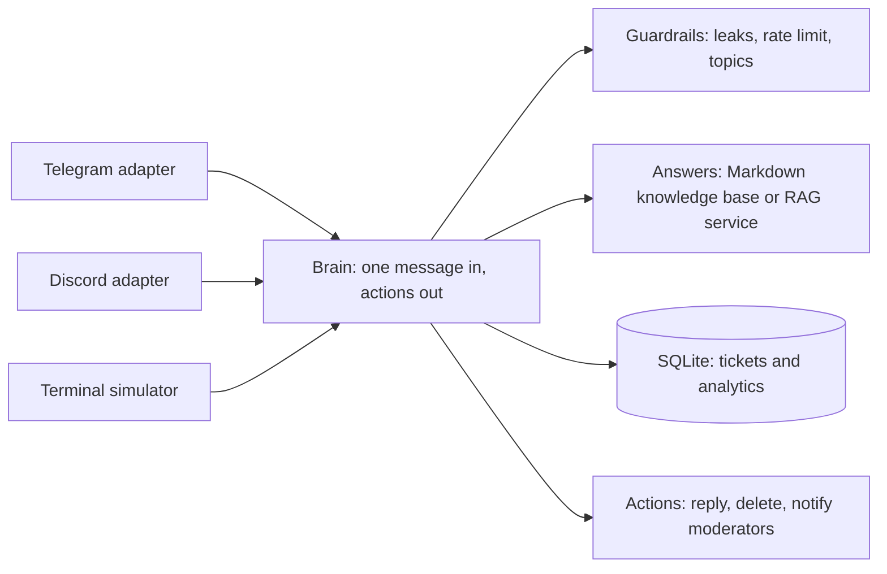

# Telegram and Discord support bot

A support bot for community chats that answers questions from your docs, hands off to a human when it is not sure, and removes seed phrases that members paste by mistake.

[](https://github.com/alex-pubgit/telegram-discord-support-bot/actions/workflows/ci.yml)


A session in a group chat, replayed by the built-in simulator (`supportbot simulate --script examples/demo.script`):

```text
alice: @bot How much is the bridge fee?
  bot: The bridge fee is 0.05% of the amount, with a minimum fee of 1 USDT equivalent. The network (gas) fee is separate.

       Source: Bridging between networks > How much is the bridge fee?
bob: gm everyone
bob: @bot When will ACME be listed on an exchange?
  bot: I don't have a reliable answer for that, so I passed it to the team (ticket #1). A moderator will reply here.
  bot -> moderators: Ticket #1 from bob on simulator: When will ACME be listed on an exchange?
carol: @bot Someone offered a wallet validation tool to fix my balance, is that real?
  bot: I don't have a reliable answer for that, so I passed it to the team (ticket #2). A moderator will reply here.

       Safety reminder: admins never message you first and never ask for your seed phrase or private key. There is no wallet validation or sync tool.
  bot -> moderators: Ticket #2 from carol on simulator: Someone offered a wallet validation tool to fix my balance, is that real?
dave: @bot should I buy ACME now?
  bot: I can't give price predictions or investment advice. I'm happy to explain how the product works.
erin: help, my wallet words are [removed: possible recovery phrase]
  (bot deleted this message)
  bot: erin, I removed your message because it looked like a wallet recovery phrase. If it was one, treat that wallet as compromised and move your funds to a new wallet now. Nobody on the team will ever ask for it.
frank: my bridge tx 0x9f2c4a7be1d3058c6fa1b2e47d90c3a85b6e1f42d7c9083a5e4b1c6d2f7a8e90 has been pending for 2 hours
mia (mod): /tickets
  bot: #1 bob (simulator): When will ACME be listed on an exchange?
       #2 carol (simulator): Someone offered a wallet validation tool to fix my balance, is that real?
mia (mod): /resolve 1
  bot: Ticket #1 resolved.
mia (mod): /stats
  bot: Last 7 days: 1 answered (33%), 2 handed off, 1 refused, 1 leaks removed, 0 rate-limited
       Unanswered most often (documentation to write next):
         1x when will acme be listed on an exchange
         1x someone offered a wallet validation tool to fix my balance is that real
       Most used sections:
         1x Bridging between networks > How much is the bridge fee?
```

This is a demo and reference implementation. The sample knowledge base describes AcmeSwap, a fictional product.

## What you get

- Answers taken from your own Markdown docs, each with the section it came from.
- A handoff instead of a guess: when no section matches well enough, the bot opens a ticket, tells the member, and notifies your moderators.
- Seed-phrase and private-key protection: the message is deleted, the member is warned, and the secret is never written to the database or the logs.
- A scam-safety reminder on questions about wallets, recovery, airdrops and "support", and a fixed refusal for price and investment questions.
- A weekly report of what members asked that the docs do not answer, so you know what to write next.
- One core with two thin adapters, so Telegram and Discord behave the same way.

## Try it in 2 minutes

No Telegram or Discord account needed. Requires Python 3.11 or newer.

```bash
git clone https://github.com/alex-pubgit/telegram-discord-support-bot.git
cd telegram-discord-support-bot
python -m venv .venv
source .venv/bin/activate        # Windows: .venv\Scripts\activate
pip install -e .

supportbot simulate --script examples/demo.script    # prints the transcript above
supportbot simulate                                   # type your own lines
```

In the simulator each line is `name: message`. Start a message with `@bot` to address the bot in the group, and write `name (mod):` for a moderator or `name (dm):` for a direct message.

## How it works



Every message goes through the same steps, in this order:

1. **Leak check.** Runs on every message, including ones not meant for the bot. A recovery phrase or private key leads to "delete and warn".
2. **Is it for the bot?** In a group the bot stays silent unless it is mentioned, replied to, or given a command.
3. **Rate limit.** Three messages at once, then one every 20 seconds per member. The first refusal is announced, the rest are silent.
4. **Commands.** `/ask`, `/human`, and for moderators `/tickets`, `/resolve <id>` and `/stats`.
5. **Answer or hand off.** The best-matching section is quoted with its source. Below the confidence threshold, the question becomes a ticket.

## Run it on Telegram

1. Create a bot with [@BotFather](https://t.me/BotFather) (`/newbot`) and copy its token.
2. Add the bot to your group and make it an admin with the "Delete messages" right. Admin bots receive every message in the group, which the leak check needs. A non-admin bot in privacy mode only sees commands, mentions and replies.
3. Copy `.env.example` to `.env` and set `TELEGRAM_BOT_TOKEN`, `SUPPORTBOT_HASH_SALT`, `SUPPORTBOT_ADMINS` (for example `telegram:123456789`) and `TELEGRAM_MODERATOR_CHAT_ID` (a group the bot is a member of).
4. `pip install -e ".[telegram]"`, then `supportbot run telegram`.

## Run it on Discord

1. In the [Developer Portal](https://discord.com/developers/applications) create an application, add a bot, and copy its token. Under Privileged Gateway Intents switch on **Message Content Intent**.
2. Invite the bot with the `bot` and `applications.commands` scopes and the permissions View Channels, Send Messages and Manage Messages.
3. In `.env` set `DISCORD_BOT_TOKEN`, `SUPPORTBOT_HASH_SALT`, `SUPPORTBOT_ADMINS` (for example `discord:987654321`) and `DISCORD_MODERATOR_CHANNEL_ID`.
4. `pip install -e ".[discord]"`, then `supportbot run discord`.

Members use `/ask` or mention the bot. Moderators mention it with a command, for example `@Bot /tickets`.

With Docker: fill in `.env`, then `docker compose up --build` for Telegram, or `docker compose --profile discord up --build` for both.

## Use your own knowledge base

Point `SUPPORTBOT_KB_DIR` at a folder of Markdown files. Each heading and the text below it is one answerable section, so headings written as the question a member would ask work best. See [sample_kb/](sample_kb/).

For written answers from a larger document set, run [rag-chatbot-with-citations](https://github.com/alex-pubgit/rag-chatbot-with-citations) and set `SUPPORTBOT_BACKEND=rag-api` and `SUPPORTBOT_RAG_API_URL`. A refusal from that service becomes a handoff here.

## Configuration

| Variable | Default | Meaning |
|---|---|---|
| `SUPPORTBOT_KB_DIR` | `sample_kb` | Folder of Markdown files |
| `SUPPORTBOT_BACKEND` | `kb` | `kb` (quote the knowledge base) or `rag-api` |
| `SUPPORTBOT_RAG_API_URL` | `http://127.0.0.1:8000` | Service used by `rag-api` |
| `SUPPORTBOT_MIN_CONFIDENCE` | `0.6` | Below this, hand off instead of answering |
| `SUPPORTBOT_ADMINS` | | Moderators, as `platform:user_id`, comma-separated |
| `SUPPORTBOT_HASH_SALT` | | Random string that keeps member ids pseudonymous. Required to run |
| `SUPPORTBOT_DB` | `supportbot.sqlite3` | Tickets and analytics |
| `SUPPORTBOT_STORE_UNANSWERED` | `true` | Keep the text of unanswered questions for the report |
| `SUPPORTBOT_SAFETY_NOTICE` | built-in text | The scam-safety reminder |
| `SUPPORTBOT_RATE_BURST` / `SUPPORTBOT_RATE_REFILL_SECONDS` | `3` / `20` | Per-member rate limit |
| `TELEGRAM_BOT_TOKEN`, `TELEGRAM_MODERATOR_CHAT_ID` | | Telegram |
| `DISCORD_BOT_TOKEN`, `DISCORD_MODERATOR_CHANNEL_ID` | | Discord |

`supportbot report --days 7` prints the same summary as `/stats` from the database.

## Quality

```bash
pip install -e ".[dev]"
pytest                      # 282 tests, no network (a guard fails any test that tries)
ruff check . && ruff format --check .
```

| Part | Status |
|---|---|
| Brain, guardrails, knowledge base, tickets, analytics, simulator | Tested offline on Python 3.11 and 3.13 (locally on Windows; CI runs them on Ubuntu) |
| Leak detector | Official BIP-39 test vectors, every standard length, punctuation and numbering variants, 34 ordinary-English paragraphs, transaction hashes |
| Telegram adapter | Real-shaped updates fed through the aiogram dispatcher with a recording session in place of Telegram's API. Not run against live Telegram |
| Discord adapter | Message translation and client construction tested. Event handlers and the slash command are not exercised, and it was not run against live Discord |
| `rag-api` backend | Mocked HTTP in the tests, plus one local run against rag-chatbot-with-citations |
| Docker image | Built and smoke-tested by CI. Not run locally |

For a live check with your own token: set `.env`, run `supportbot run telegram`, then send the bot a question, `/human test`, and a BIP-39 test vector in a test group.

## Design decisions

- **A pure core.** `SupportBrain.handle(message)` returns a list of actions and imports nothing from Telegram or Discord. Every rule is tested without a network, and the simulator is a third adapter, not a mock.
- **A transaction hash is not a private key.** Both are 64 hex characters, and members paste transaction hashes whenever they ask for help. Hex is treated as a secret only when words such as "private key" sit next to it, and closer than any word such as "tx" or "hash".
- **Detection never holds the secret.** A finding records where the secret is and what kind it is, never its text. Tickets and analytics store the redacted form, and a test dumps the database to prove it.
- **Leak check before everything.** It runs before the "is this for me" filter and before rate limiting, because a leaked phrase in a message that was not addressed to the bot is the common case.
- **Confidence instead of a BM25 threshold.** BM25 scores depend on the question, so the bot compares the share of the question's rare words that a section covers. An undocumented topic scores low even when it shares common words with the docs.
- **Hand off on failure.** If the answer service is down, the member gets a ticket, not an error.
- **Pseudonymous analytics.** Usage rows carry a salted hash of the member id. Tickets keep the display name, because a moderator has to reply to someone.

## Limitations

- A bare list of 12 or more words that all happen to be on the BIP-39 list, such as a long comma-separated shopping list, is removed as a possible recovery phrase. The detector prefers a false alarm to leaving a real phrase in the chat, and the warning says it may be wrong.
- A phrase split across several messages is not detected, and neither are non-English wordlists.
- The built-in backend quotes sections and matches words, not meaning. Use the `rag-api` backend for paraphrased questions and written answers.
- Deleting needs the right permission on each platform, and a Discord bot cannot delete a member's direct message. The warning is sent either way.
- One process handles one message at a time. That is fine for a community chat and wrong for a high-volume service.
- No anti-spam, raid protection or broadcast features. This bot only answers when asked and never messages members first.

## Project layout

```text
src/supportbot/
  brain.py                 the rules: message in, actions out
  guardrails/              leak detection, rate limit, sensitive-topic checks
  kb/                      Markdown loader, BM25, confidence scoring
  answer.py                knowledge-base and RAG-service backends
  storage.py               tickets and analytics (SQLite)
  adapters/                Telegram (aiogram) and Discord (discord.py)
  simulator.py, cli.py     terminal simulator and commands
sample_kb/                 fictional FAQ used by the demo and the tests
examples/                  demo script and its transcript
```

## Need this adapted to your community?

I build bots like this for real projects: your docs, your moderation flow, deployed on your server. See [github.com/alex-pubgit](https://github.com/alex-pubgit).

## License

MIT. See [LICENSE](LICENSE). The bundled BIP-39 wordlist is MIT-licensed; see [src/supportbot/data/README.md](src/supportbot/data/README.md).
